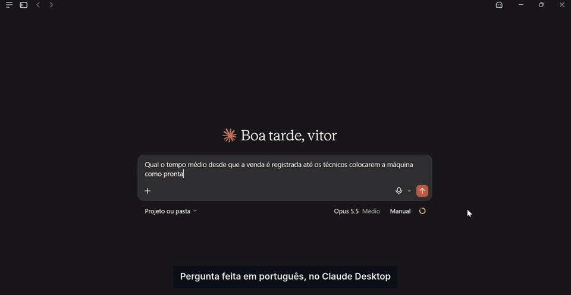
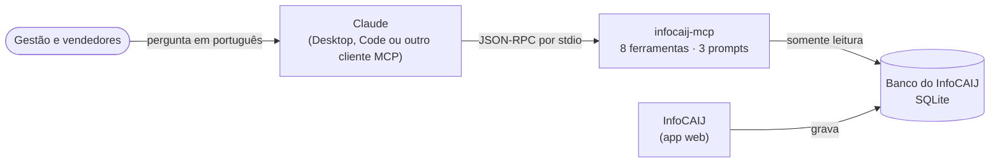

# InfoCAIJ MCP

**Pergunte ao Claude como está a operação, em português, e receba a resposta calculada a partir dos dados reais do sistema.**

   



<sub>Gravação real no Claude Desktop, com o banco da operação. Esperas aceleradas.</sub>

Servidor [Model Context Protocol](https://modelcontextprotocol.io) que conecta o **InfoCAIJ**, a plataforma interna que acompanha cerca de 300 máquinas por mês na CAIJ Informática, ao Claude e a qualquer outro cliente MCP. A gestão deixa de abrir telas e montar planilhas para perguntar coisas como:

> **"Onde a nossa fila está travando no último mês? Compare com a última semana."**
>
> O Claude chama `tempo_por_etapa({"dias": 30})`, `tempo_por_etapa({"dias": 7})` e `resumo_fila({})` e responde:
>
> **A fila trava em "Aguardando nota fiscal", tanto no último mês quanto na última semana.** A mediana de cerca de 22 a 25 horas equivale a mais da metade do tempo de venda até a entrega, que é de 42 a 48 horas. [...] Das 27 máquinas em aberto, 15 estão aguardando nota fiscal.

[Ver as sessões completas →](docs/demonstracao.md)

## O que ele responde

| Pergunta de negócio | Ferramenta | Como calcula |
|:--|:--|:--|
| "Como está a bancada agora?" | `resumo_fila` | Máquinas por etapa, prioritárias e a mais antiga de cada etapa |
| "O que está travado há mais de 2 dias?" | `itens_parados` | Tempo desde a última mudança de etapa, filtrável por etapa |
| "Quanto tempo da venda até a máquina ficar pronta?" | `tempo_entre_etapas` | Média, mediana e p90 entre dois pontos da fila, por técnico, plataforma ou empresa; conta quem pulou etapas |
| "Onde a fila trava?" | `tempo_por_etapa` | Mediana e p90 de cada etapa, reconstruídos do histórico, e o gargalo |
| "Quantas máquinas a bancada fechou esta semana?" | `produtividade` | Máquinas que chegaram a Pronta e a Entregue, por técnico e por dia |
| "Quanto vendemos por plataforma?" | `vendas` | Pedidos, máquinas, cancelamentos e devoluções por plataforma, empresa, vendedor ou dia |
| "Temos ThinkPad pronto?" | `estoque` | Unidades por situação e loja, e modelos disponíveis |
| "Em que pé está a máquina CN27YDZ?" | `consultar_maquina` | Dossiê por serial, código ou OS: venda, nota, checklist, garantia e histórico |

E três **prompts** prontos, que o usuário escolhe no menu do Claude:

| Prompt | O que entrega |
|:--|:--|
| `relatorio_semanal` | Relatório para a gestão: entregas, gargalo da semana contra o mês, máquinas paradas, ritmo por técnico, vendas e uma recomendação baseada em número |
| `diagnostico_gargalo` | Investigação de uma etapa: tempos, máquinas presas e o padrão no histórico das mais antigas, com a hipótese marcada como hipótese |
| `status_pedido` | Resposta para o vendedor, em até 3 frases, no tom de uma mensagem de WhatsApp |

## Como funciona



O ponto central é o **`tempo_por_etapa`**. O InfoCAIJ não guarda quanto tempo cada máquina ficou em cada etapa; ele guarda um histórico de eventos como `Status alterado de Aguardando retirada para Aguardando nota fiscal.`. O servidor reconstrói a linha do tempo de cada máquina a partir desses eventos e calcula mediana e percentil 90 por etapa. Foi assim que a pergunta "onde a fila trava?" ganhou resposta com número.

## Decisões de projeto

**Somente leitura em duas camadas.** O arquivo é aberto com `readOnly` pelo driver e a conexão recebe `PRAGMA query_only`. Um teste roda todas as ferramentas e confere que o hash do banco não muda.

**Nenhum dado pessoal de cliente.** O banco tem nomes, e-mails e telefones de clientes em garantias e cadastros. Nenhuma consulta seleciona essas colunas, e não há `SELECT *`. O banco de demonstração planta dados pessoais falsos, e um teste consulta todas as 314 máquinas com garantia para provar que nada vaza.

**Ferramentas de negócio, não SQL livre.** Uma ferramenta "execute este SQL" seria mais flexível e muito menos segura: o modelo poderia ler qualquer tabela. Cada ferramenta responde a uma pergunta que a operação faz de verdade, com argumentos validados (enums, limites e tamanho máximo).

**A descrição da ferramenta é o prompt.** O modelo escolhe a ferramenta lendo a descrição, então cada uma diz quando usá-la, com exemplos de pergunta. Erros de argumento voltam como resultado com `isError`, para o modelo corrigir a chamada sozinho em vez de a conversa quebrar.

**Zero dependências.** O protocolo MCP (JSON-RPC 2.0 por stdio) está implementado em cerca de 170 linhas, com o `node:sqlite` embutido no Node. Para um servidor que lê dados da empresa, isso significa nada de terceiros para auditar e instalação com um `git clone`.

## Avaliado com o modelo, não só com testes

Além dos 20 testes automatizados, o servidor foi conectado ao Claude Code e testado com perguntas reais. Uma das sessões mostrou um problema que nenhum teste unitário pegaria:

| | |
|:--|:--|
| **Pergunta** | "Quantas máquinas vendemos por plataforma nos últimos 30 dias, e onde há mais devolução?" |
| **Antes** | O modelo respondeu certo, mas avisou: *"não sei se a ferramenta conta a devolução pela data da venda ou pela data da devolução."* |
| **Causa** | A descrição de `vendas` não dizia qual data define o período. |
| **Correção** | A descrição passou a dizer que o período é pela data da venda e como calcular a taxa de devolução. |
| **Depois** | O modelo passou a calcular a taxa por plataforma direto ("Cassio: 3 devoluções em 62 máquinas, 4,8%") e deixou de hesitar. |

O segundo problema só apareceu com o banco real:

| | |
|:--|:--|
| **Sintoma** | Nos dados de demonstração, o gargalo era claro. No banco real, o servidor apontou "Pronta", uma etapa com mediana de 0,8 h. |
| **Causa** | O gargalo era escolhido pela mediana. Em "Aguardando retirada", a maioria das máquinas passava em menos de 1 h, mas os 10% piores esperavam mais de 3 dias. A mediana escondia essa cauda. |
| **Correção** | O gargalo passou a ser a etapa onde as máquinas somam mais horas paradas, com a participação de cada etapa no total. A ferramenta também passou a listar etapas que a equipe não usa. |
| **Garantia** | Um teste reproduz o caso: 9 máquinas passam em 1 h e 1 fica 100 h, e o gargalo tem de ser essa etapa. |

## Instalação

Requer **Node.js 22.18 ou superior** (roda TypeScript direto, sem build). Nada para instalar além disso.

```bash
git clone https://github.com/VitorTosti/infocaij-mcp.git
cd infocaij-mcp
npm test          # 20 testes
npm run seed      # cria demo/infocaij-demo.sqlite com dados fictícios
```

### Claude Code

```bash
claude mcp add infocaij \
  -e INFOCAIJ_DB_PATH=/caminho/para/controle-vendas-os.sqlite \
  -- node --disable-warning=ExperimentalWarning /caminho/para/infocaij-mcp/src/server.ts
```

### Claude Desktop

Em `claude_desktop_config.json` (no Windows, `%APPDATA%\Claude\claude_desktop_config.json`):

```json
{
  "mcpServers": {
    "infocaij": {
      "command": "node",
      "args": ["--disable-warning=ExperimentalWarning", "C:\\caminho\\para\\infocaij-mcp\\src\\server.ts"],
      "env": { "INFOCAIJ_DB_PATH": "C:\\caminho\\para\\controle-vendas-os.sqlite" }
    }
  }
}
```

### Banco em servidor remoto

Se o banco está numa VPS, o cliente pode iniciar o servidor por SSH. Nenhuma porta nova é aberta, e o banco nunca sai do servidor:

```json
{
  "mcpServers": {
    "infocaij": {
      "command": "ssh",
      "args": ["-T", "usuario@servidor", "INFOCAIJ_DB_PATH=/srv/infocaij/data/controle-vendas-os.sqlite node --disable-warning=ExperimentalWarning /srv/infocaij-mcp/src/server.ts"]
    }
  }
}
```

### Para testar sem o banco real

```bash
npm run seed
claude mcp add infocaij-demo \
  -e INFOCAIJ_DB_PATH=$PWD/demo/infocaij-demo.sqlite \
  -e INFOCAIJ_MCP_NOW=2026-10-28T21:00:00.000Z \
  -- node --disable-warning=ExperimentalWarning $PWD/src/server.ts
```

O banco de demonstração simula 45 dias de operação (cerca de 480 máquinas e 4.600 eventos) com o mesmo esquema do InfoCAIJ. Todos os nomes são inventados.

## Estrutura

```text
src/
  server.ts     transporte stdio
  protocol.ts   MCP: initialize, tools/*, prompts/*, erros JSON-RPC
  tools.ts      definição, descrição e validação das 8 ferramentas
  queries.ts    consultas e reconstrução da linha do tempo por máquina
  prompts.ts    os 3 prompts prontos
  db.ts         abertura somente leitura
  domain.ts     etapas e vocabulário do InfoCAIJ
scripts/seed-demo.ts   banco de demonstração com o mesmo esquema
test/                  protocolo, cálculos com valores conhecidos, segurança e privacidade
docs/demonstracao.md   sessões reais com o Claude
```

## Limitações

- Tempos em horas corridas, não horas úteis.
- O técnico de `produtividade` é o responsável atual da máquina, não necessariamente quem a moveu de etapa.
- Lê o banco SQLite. O InfoCAIJ também suporta PostgreSQL; um adaptador é o próximo passo.

## Autoria

**Vitor Tosti**: levantamento das perguntas da operação, desenho das ferramentas e prompts, implementação, testes e avaliação com o modelo. Construído com o Claude Code.

[LinkedIn](https://www.linkedin.com/in/vitortosti/) · [Estudo de caso do InfoCAIJ](https://github.com/VitorTosti/infocaij-case-study)
